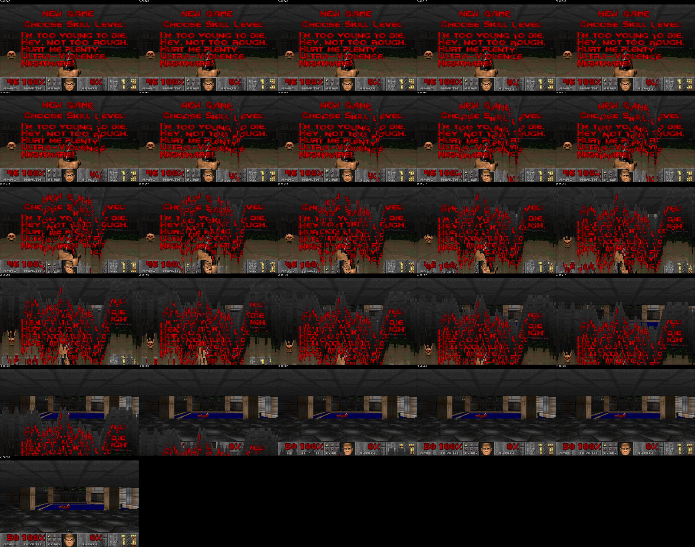

# Rip & Tear

**Category:** Misc
**Challenge author:** `ipaljak`
**Flag:** `FortID{Kn33_Deep_1n_7h3_Fl4gZ!1}`

## Description

The handout is a patch for [Chocolate Doom](https://github.com/chocolate-doom/chocolate-doom)
([`chocolate-doom.patch`](./chocolate-doom.patch)) and a `gameplay.mkv`
recording of someone playing the patched build. The flag never appears on
screen and is not written anywhere in the patch — it has to be recovered from
how the game *behaves* in the video.

> The `gameplay.mkv` recording (~161 MB) is not committed here; it was provided
> by the challenge. The solver below expects it in the working directory.

## Initial analysis

The patch adds one initialiser to `src/doom/m_random.c`:

```c
static const char* FLAG = "FortID{<REDACTED>}";   // 32 bytes, asserted

for (i = 0; i < 256; ++i) {
    byteIndex = i / 8;
    bitIndex  = 7 - (i % 8);
    flagBit   = (FLAG[byteIndex] >> bitIndex) & 1;
    rndtable[i] ^= flagBit;          // XOR one flag bit into each table entry
}
```

Two numbers jump out:

- the flag is exactly **32 bytes**, and
- Doom's random table (`rndtable`) has exactly **256 entries**.

Since `32 × 8 = 256`, **every table entry stores exactly one flag bit**, MSB
first (entries 0–7 = `F`, 8–15 = `o`, …). The XOR only ever flips the lowest
bit of a random value. So the question becomes: *how does the recording leak
individual random values?*

## The core trick — Doom's screen "melt" leaks the RNG

Doom's between-screens transition (`src/doom/f_wipe.c`) is the famous melting
effect, and it is driven straight off `M_Random()`:

```c
y[0] = -(M_Random() % 16);                 // first column's start delay
for (i = 1; i < width; i++) {
    r    = (M_Random() % 3) - 1;           // -1, 0, or +1 vs. the neighbour
    y[i] = y[i-1] + r;
    if (y[i] > 0)        y[i] = 0;
    else if (y[i] == -16) y[i] = -15;
}
```



Each `y[i]` is a vertical strip's starting delay, visible as how far that column
has fallen mid-wipe. The random value shows through its `% 16` (first column) or
`% 3` (every other column), and flipping its lowest bit usually changes that
remainder — which tells us whether the hidden flag bit was 0 or 1.

Chocolate Doom packs two neighbouring pixels into one `dpixel_t`, so a 320-px
screen gives **160 melt columns** → up to 160 consecutive bits per wipe. A few
wipes cover all 256 entries and resolve columns that hit the `0` / `-15` clamps.

## Exploitation

[`solve.py`](./solve.py):

1. For each useful wipe, grab three native-resolution frames (before / during /
   after) by cropping the 1920×1080 video back to Doom's 320×200.
2. For all 160 columns, brute-force the melt boundary (new screen above, shifted
   old screen below) with the lowest pixel error → the measured melt height.
3. Convert heights to each column's initial `y` delay, accounting for the melt's
   acceleration (`dy = y < 16 ? y+1 : 8`) and the game tick count `N` at that
   frame.
4. Knowing `M_Random()` advances its index before returning
   (`rndindex = (rndindex+1) & 0xff`), map each column back to a table entry and
   deduce the single flag bit consistent with the observed `y` path.
5. Pin the known `FortID{` prefix and `}` suffix, process the clean static-screen
   wipes first, and use the noisier gameplay wipe only for the one byte still
   missing (bits 136–143).

The three wipes used:

| Wipe                     | before / mid / after | first entry | tick `N` |
|--------------------------|---------------------:|------------:|---------:|
| Title/menu (static)      | 116 / 155 / 180      | 232         | 25       |
| Intermission (static)    | 11127 / 11155 / 11184| 144         | 17       |
| New-game (fills last byte)| 349 / 373 / 410     | 2           | 23       |

## Running it

```bash
git clone https://github.com/chocolate-doom/chocolate-doom src_repo
python3 -m pip install numpy opencv-python
python3 solve.py          # expects gameplay.mkv and src_repo/ in the cwd
```

```text
FortID{Kn33_Deep_1n_7h3_Fl4gZ!1}
```

## Key takeaways

- A 32-byte flag has exactly as many bits as Doom's 256-entry RNG table — the
  numeric coincidence is the whole design.
- XOR with a single bit only perturbs a value's low bit, and `% 16` / `% 3` in
  the melt code make that perturbation *observable*.
- You didn't have to beat Doom; you had to measure how Doom *melted*. Reconstruct
  the algorithm from source, then read its output off the pixels.
- Side channels love visual effects: anything derived from "random" and drawn to
  the screen can leak the seed/state.
